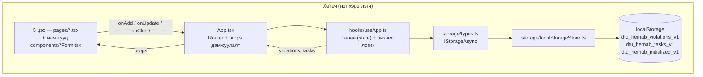
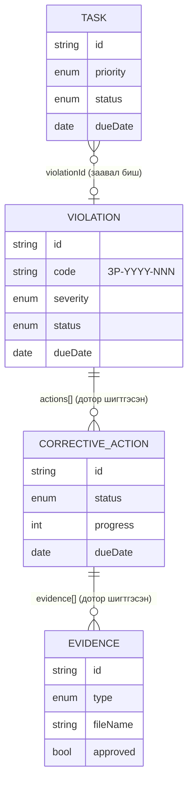
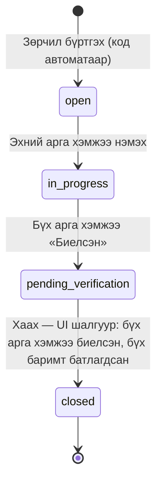
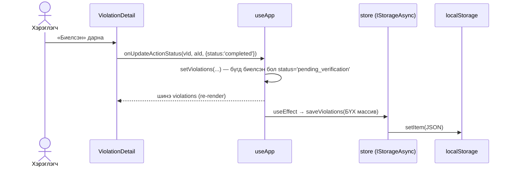
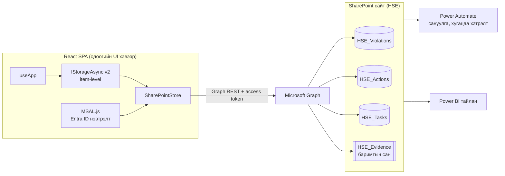

# ДТҮ ХЭМАБ веб систем — Архитектур ба урьдчилсан загвар

| Үзүүлэлт | Утга |
|---|---|
| Суурь commit | `3439c15` (branch `claude/dtu-hemab-web-continuation-fgdtj5`) |
| Баримтын төлөв | Одоогийн кодын бодит тайлбар + SharePoint шилжилтийн **санал** (батлагдаагүй) |
| Технологи | React 18 + TypeScript 5.6 + Vite 6 + Tailwind 3 + react-router 6 |
| Хадгалалт | `localStorage` (`LocalStorageStore : IStorageAsync`) |
| Нэвтрэлт | Байхгүй. Хэрэглэгчийн нэр `'Б. Дорж'` гэж кодонд бичигдсэн |

Тэмдэглэгээ: **[БАЙГАА]** = кодонд хэрэгжсэн, **[САНАЛ]** = хэрэгжээгүй, шийдвэр шаардлагатай.

---

## 1. Шалгалтын үр дүн (3439c15)

| Шалгалт | Үр дүн | Тайлбар |
|---|---|---|
| `npm run build` (tsc + vite) | ✅ Амжилттай | JS 261.8 kB (gzip 72.8 kB) |
| `npx playwright test` | ✅ 9/9 passed (21.3 с) | Энэ орчинд дахин ажиллуулж баталгаажуулсан. Файлд 10 сценари, 5+6 нэгтгэгдсэн тул 9 тест |
| Өгөгдөл хамгаалалт, хаалтын логикийн засвар | ⚠️ **Дуусаагүй** | 457443d-ээс хойш зөвхөн IStorageAsync refactor хийгдсэн. Нээлттэй асуудлыг §6-д харуулав |

---

## 2. Системийн ерөнхий бүтэц [БАЙГАА]

Давхаргын зарчим: хуудсууд хадгалалтын талаар мэдэхгүй; бүх өөрчлөлт `useApp` → `store`-оор дамжина. Хадгалалтыг солих цэг нь ганцхан `src/storage/index.ts`.

---

## 3. 5 цэсийн дэлгэцийн бүтэц [БАЙГАА]

| # | Цэс (зам) | Үндсэн хэсгүүд | Үйлдэл | Дэлгэц |
|---|---|---|---|---|
| 1 | Хяналтын самбар (`/`) | Зөрчлийн статистик (нийт, нээлттэй, хэрэгжиж буй, баталгаажуулалт хүлээж буй, энэ сар хаасан, хугацаа хэтэрсэн); Даалгаврын статистик; Хүндрэлтэй зөрчлүүд; Хугацаа хэтэрсэн арга хэмжээ; анхааруулгын зурвас | Зөвхөн харах, холбоосоор шилжих | [1-dashboard.png](screens/1-dashboard.png) |
| 2 | Зөрчлийн бүртгэл (`/violations`) | Хайлт (код, тайлбар, байршил); шүүлтүүр: статус, ноцтой байдал; карт жагсаалт + арга хэмжээний явцын мөр | Шинэ зөрчил, засах (хаагдаагүй үед) | [2-violations.png](screens/2-violations.png) |
| 2б | Зөрчлийн дэлгэрэнгүй (`/violations/:id`) | Толгой мэдээлэл, зөрчсөн дүрэм; залруулах арга хэмжээний жагсаалт; нотлох баримт (батлах/татгалзах); «Хаах» товч + шалтгаан | Арга хэмжээ нэмэх/засах, явц/биелэлт, баримт нэмэх, батлах, хаах | [2b-violation-detail.png](screens/2b-violation-detail.png) |
| 3 | Үүрэг даалгавар (`/tasks`) | Хайлт (нэр, тайлбар, хариуцагч); шүүлтүүр: статус, яаралтай байдал; жагсаалт, холбоотой зөрчил | Шинэ даалгавар, засах, статус солих | [3-tasks.png](screens/3-tasks.png) |
| 4 | Арга хэмжээний төлөвлөгөө (`/actions`) | Бүх зөрчлийн арга хэмжээг статусаар бүлэглэсэн (хүлээгдэж буй, хэрэгжиж буй, баталгаажуулалт хүлээж буй, хугацаа хэтэрсэн, биелсэн) | Зөвхөн харах | [4-action-plan.png](screens/4-action-plan.png) |
| 5 | Хугацаа хэтэрсэн (`/overdue`) | Хугацаа хэтэрсэн зөрчил, арга хэмжээ, даалгавар — 3 хэсэг, нийт тоо | Зөвхөн харах | [5-overdue.png](screens/5-overdue.png) |

Маягтын заавал бөглөх талбарууд:

- **Зөрчил:** шалгалтын огноо, хаах хугацаа, шалгалтын төрөл, шалгагч, хариуцагч, байршил, ангилал, ноцтой байдал, тайлбар (+ зөрчсөн дүрэм — заавал биш)
- **Арга хэмжээ:** тайлбар, хариуцагч, биелэх хугацаа (+ тэмдэглэл)
- **Даалгавар:** гарчиг, хариуцагч, дуусах хугацаа, зэрэглэл, ангилал (+ тайлбар, холбоотой зөрчил, шошго)
- **Нотлох баримт:** төрөл (баримт/зураг/тайлан), тайлбар, файлын **нэр**. Файл өөрөө хавсаргагдахгүй — зөвхөн нэр хадгалагдана.

---

## 4. Өгөгдлийн загвар ба мэдээллийн урсгал [БАЙГАА]

### 4.1 Зөрчлийн амьдралын мөчлөг

### 4.2 Нэг үйлдлийн урсгал (жишээ: арга хэмжээ биелүүлэх)

Онцлог: хадгалалт нь **бүх массивыг дахин бичих** зарчимтай (item-level биш). localStorage-д тохирох боловч SharePoint-д тохирохгүй (§5.3).

---

## 5. Ирээдүйн SharePoint архитектур [САНАЛ — батлагдаагүй]

### 5.1 Зорилтот бүтэц

### 5.2 Жагсаалтын санал (шигтгэсэн массивыг салгана)

| Жагсаалт | Гол багана | Холбоос |
|---|---|---|
| HSE_Violations | Code, InspectionDate, InspectionType, Inspector, Location, Category, Severity, Status, DueDate, AssignedTo (Person), Regulation, ClosedDate, ClosedBy (Person) | — |
| HSE_Actions | Description, Responsible (Person), DueDate, CompletedDate, Status, Progress, VerifiedBy, Notes | ViolationId (Lookup) |
| HSE_Evidence (Document library) | Файл, EvidenceType, Description, Approved, ApprovedBy, ApprovedDate, RejectedReason | ActionId (Lookup) |
| HSE_Tasks | Title, Description, AssignedTo (Person), DueDate, Priority, Status, Category, Tags | ViolationId (Lookup, заавал биш) |

Шүүлтүүрт ордог багануудыг (Status, DueDate, ViolationId) **индексжүүлэх** — 5000 мөрийн list view threshold-оос хамгаална.

### 5.3 Шилжихээс өмнө шийдэх архитектурын асуудлууд

| # | Асуудал | Яагаад чухал | Санал |
|---|---|---|---|
| A1 | `saveViolations(бүх массив)` | SharePoint-д нэг өөрчлөлт бүрд бүх мөрийг дахин бичнэ → Graph throttling (429), олон хэрэглэгч бие биенийхээ өөрчлөлтийг дарж бичнэ | `IStorageAsync`-ийг item-level болгох: `createViolation`, `updateViolation(id, patch, etag)`, `createAction`, `addEvidence(file)` г.м. **Энэ нь одоогийн интерфейсийг өөрчилнө — зөвшөөрөл шаардлагатай** |
| A2 | Код (`ЗР-YYYY-NNN`) клиент дээр тооцоолох | Хоёр хэрэглэгч зэрэг бүртгэвэл давхардана | Power Automate эсвэл SharePoint ID-д суурилсан дугаарлалт (сервер тал) |
| A3 | Давхцах засварын хамгаалалт байхгүй | Сүүлд хадгалсан нь ялна | Graph `If-Match: eTag` → 412 үед хэрэглэгчид мэдэгдэх |
| A4 | Нэвтрэлт, эрх байхгүй (`'Б. Дорж'` hardcode) | Хэн баталсан, хэн хаасныг нотлох боломжгүй — ISO 45001 7.5 баримтжуулсан мэдээлэлд сул | MSAL.js + Entra app registration; Graph эрх `Sites.Selected` (зөвхөн HSE сайтад); үүрэг: Бүртгэгч / Хариуцагч / Баталгаажуулагч |
| A5 | Нотлох баримт = зөвхөн файлын нэр | Аудитын нотолгоо болохгүй | HSE_Evidence баримтын сан руу бодит файл байршуулах |
| A6 | Офлайн / уурхайн сүлжээ | Төмөртэй, Төмөр толгойн сүлжээний чанар **мэдээлэл дутуу** | Хэрэгцээг тодорхойлсны дараа шийдэх; эхний шатанд онлайн-only |

### 5.4 Шилжилтийн дараалал (санал)

1. §6-ийн хаалтын логик, өгөгдөл хамгаалалтын засвар (localStorage дээр, тесттэй)
2. `IStorageAsync` v2 (item-level) — `LocalStorageStore`-оор эхлээд хэрэгжүүлж, 9 E2E тест ногоон байх
3. SharePoint сайт, 4 жагсаалт/сан үүсгэх, индекс тохируулах (IT-тэй)
4. Entra app registration + MSAL нэвтрэлт
5. `SharePointStore` + ETag, алдааны боловсруулалт
6. Power Automate (код олгох, сануулга), Power BI холболт

---

## 6. Нээлттэй асуудлууд (кодоор баталгаажуулсан) — засвар хийгдээгүй

| # | Асуудал | Байршил | Нөлөө |
|---|---|---|---|
| B1 | Арга хэмжээг нотлох баримтгүйгээр «Биелсэн» болгож, зөрчлийг хааж болно (`[].every(...)` = `true`) | `src/pages/ViolationDetail.tsx:326-329` | Нотолгоогүй хаалт — аудитын эрсдэл |
| B2 | Татгалзсан баримттай арга хэмжээ «Биелсэн» болсон бол шинэ баримт нэмэх товч нуугдана, хаалт байнга хаагдана (гацаа) | `ViolationDetail.tsx` (баримт нэмэх нь `status !== 'completed'` үед л) | Зөрчил хаагдах боломжгүй болно |
| B3 | Хаах шалгуур зөвхөн UI-д; `closeViolation` hook-д шалгалтгүй | `src/hooks/useApp.ts` `closeViolation` | Өөр замаар дуудвал шалгуургүй хаагдана |
| B4 | `localStorage.setItem` синхрон exception (квот дүүрэх) `.catch()`-д баригдахгүй | `src/storage/localStorageStore.ts` `save*` | Хадгалагдаагүй байхад хэрэглэгч мэдэхгүй / апп унах |
| B5 | `pending_verification` төлөвтэй зөрчилд шинэ арга хэмжээ нэмэхэд төлөв буцаж `in_progress` болохгүй | `useApp.ts` `addAction` | Статистик буруу |
| B6 | Өгөгдлийн схемийн хувилбар/шилжүүлэлт, экспорт/нөөц байхгүй | `storage/*` | Хөтчийн өгөгдөл устгавал бүх бүртгэл алга болно |
| B7 | Огноо `mn-MN` locale-оор форматлагдахгүй, MM/DD/YYYY болон англиар харагдана (Chromium) | `utils/helpers.ts` `formatDate`, `Layout.tsx` | Дэлгэцийн зураг дээр баталгаажсан; UX |

Эдгээрийг засах эсэх, дарааллыг хэрэглэгч/хянагч батална.
